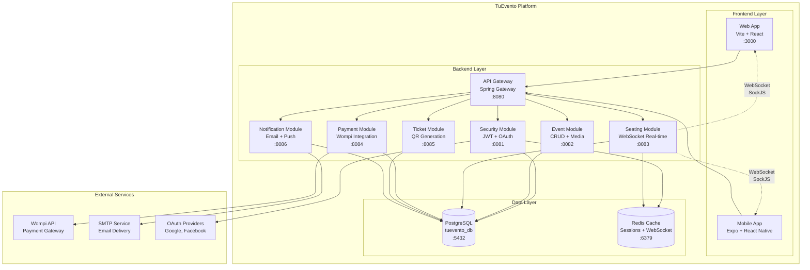

# TuEvento — System Architecture Overview

> **Architecture snapshot of TuEvento** — Event management platform with real-time seat reservation,
> payment processing, and QR-based ticket validation. Designed for web organizers and mobile/web attendees.

---

## 1. Adopted architectural style

**Style:** N-Layer Architecture with Domain-Driven Design (DDD) oriented toward Microservices

**Justification:** 
- **Domain complexity** requires clear bounded contexts (Security, Events, Seating, Payments, etc.)
- **Real-time requirements** (WebSocket seat updates) need dedicated service isolation
- **Payment integration** demands strict security boundaries and audit trails
- **Multi-platform support** (web + mobile) benefits from API-first microservices approach
- **Team size (2 developers)** makes monolithic deployment simpler while maintaining modular structure

**Reference ADR:** [`ADR-002-n-layer-ddd-architecture.md`](decisions/records/)

---

## 2. C4 Diagram — System Level (Context)

> TuEvento in the ecosystem: external actors, integrations, and system boundaries.

```
                          ┌─────────────────────────────────────────────┐
                          │                TuEvento                     │
                          │        Event Management Platform            │
                          │                                             │
    ┌─────────────┐      │  ┌─────────────┐    ┌─────────────────────┐ │      ┌──────────────┐
    │ Organizers  │────────▶│ Web App     │    │   Backend API       │ │      │    Wompi     │
    │ (Web Only)  │      │  │ (Vite)      │    │  (Spring Boot)      │ │◀─────│ Payment      │
    └─────────────┘      │  └─────────────┘    └─────────────────────┘ │      │ Gateway      │
                         │                                              │      └──────────────┘
    ┌─────────────┐      │  ┌─────────────┐    ┌─────────────────────┐ │            │
    │ Attendees   │────────▶│ Mobile App  │    │  WebSocket Service  │ │            │
    │ (Mobile +   │      │  │ (Expo)      │    │    (SockJS)         │ │            │
    │  Web)       │      │  └─────────────┘    └─────────────────────┘ │            │
    └─────────────┘      │                                              │            │
                         │  ┌─────────────┐    ┌─────────────────────┐ │      ┌──────▼──────┐
    ┌─────────────┐      │  │ Admin Panel │    │   PostgreSQL DB     │ │      │    SMTP     │
    │ Admins      │────────▶│ (Future)    │    │  (tuevento_db)      │ │      │ Email       │
    │ (System)    │      │  └─────────────┘    └─────────────────────┘ │      │ Service     │
    └─────────────┘      │                                              │      └─────────────┘
                         └─────────────────────────────────────────────┘
```

**External integrations:**
- **Wompi API** — Payment processing (cards, PSE, Nequi, cash)
- **SMTP Service** — Email notifications and ticket delivery
- **OAuth Providers** — Social login (Google, Facebook)

**User types:**
- **Organizers** — Create events, design layouts, manage sales (web exclusive)
- **Attendees** — Browse events, purchase tickets, QR check-in (web + mobile)  
- **Admins** — System management, organizer approvals

---

## 3. C4 Diagram — Container Level

> Internal TuEvento architecture: modules, databases, and communication patterns.



---

## 4. Module catalog

> TuEvento follows N-Layer DDD with modular architecture within a Spring Boot monolith.

| # | Module | Responsibility | Bounded Context | Database Schema | Communication |
|---|--------|---------------|-----------------|-----------------|---------------|
| 1 | **Security** | Authentication, authorization, roles, JWT | Identity & Access Management | `user`, `role`, `auth_session` | REST + Events |
| 2 | **Profile** | User profiles, preferences, activity logs | User Management | `profile`, `preferences`, `activity_log` | REST |
| 3 | **Event** | Event CRUD, media, layouts, ratings | Event Management | `event`, `event_media`, `event_layout` | REST + Events |
| 4 | **Category** | Hierarchical event categorization | Event Classification | `category`, `category_event` | REST |
| 5 | **Geolocation** | Venues, cities, coordinates | Geographic Context | `department`, `city`, `site` | REST |
| 6 | **Section** | Event sections, capacity, pricing | Venue Layout | `event_section`, `section_type` | REST |
| 7 | **Seat** | Individual seats, real-time status | Seat Management | `seat`, `seat_block`, `seat_log` | REST + WebSocket |
| 8 | **Ticket** | Ticket generation, QR codes, check-in | Ticketing System | `ticket`, `ticket_log`, `ticket_checkin` | REST + Events |
| 9 | **Payment** | Wompi integration, order processing | Payment Processing | `order`, `payment`, `refund` | REST + Webhooks |
| 10 | **Wallet** | Digital wallet, transactions | Digital Payments | `wallet`, `wallet_transaction` | REST |
| 11 | **Notification** | Email, push notifications | Communication | `notification`, `notification_user` | Events + External |
| 12 | **Theme** | UI customization | User Experience | `theme`, `user_theme` | REST |
| 13 | **Language** | Internationalization (ES/EN/PT/JA) | Localization | `language`, `*_translation` | REST |

> **Architecture pattern:** Each module follows hexagonal architecture with domain/application/infrastructure/interfaces layers.
> Detailed per-module documentation: `09-microservices/service-catalog.md`

---

## 5. Architectural principles

These principles guide TuEvento's technical decisions and ensure consistency across development.

### P1: Domain-First Design
Design bounded contexts and domain models before implementation. 
Domain logic is isolated in the domain layer and independent of frameworks.

### P2: API-First Approach
Design OpenAPI contracts before implementing endpoints.
REST APIs are the primary integration mechanism between modules and external clients.

### P3: Real-time by Design
Critical user interactions (seat selection) use WebSockets for immediate feedback.
State changes are broadcast to all connected clients within 100ms.

### P4: Security by Default
All endpoints require authentication unless explicitly marked as public.
Sensitive operations (payments, personal data) have additional authorization layers.

### P5: Audit Everything Critical
Financial transactions, seat reservations, and ticket operations are fully audited.
Audit logs include who, what, when, and why for compliance and debugging.

### P6: Fail Fast, Recover Gracefully
Input validation at controller boundaries. External service failures use circuit breakers.
Seat reservations auto-expire after 15 minutes to prevent orphaned locks.

### P7: Observability by Design
Structured JSON logs with correlation IDs. Health checks for all critical components.
Performance metrics for payment processing and WebSocket connections.

---

## 6. Adopted architectural patterns

| Pattern | Adopted | Implementation | Reference |
|---------|---------|---------------|-----------|
| **Hexagonal Architecture** | Yes | Each module has domain/application/infrastructure/interfaces layers | `05-architecture/hexagonal-architecture.md` |
| **Domain-Driven Design** | Yes | Bounded contexts mapped to modules, rich domain models | `02-domain/evidence/domain-map.md` |
| **Repository Pattern** | Yes | Data access abstraction in infrastructure layer | Module infrastructure layer |
| **Event-Driven Architecture** | Partial | Domain events for cross-module communication | Domain events in each module |
| **CQRS** | No | Simple CRUD operations sufficient for current complexity | Not needed |
| **Event Sourcing** | No | Audit logging covers compliance requirements | ADR-007 |
| **Circuit Breaker** | Yes | Resilience4j for external service calls | Pattern guide |
| **WebSocket Real-time** | Yes | SockJS for seat reservation updates | Seat module |
| **Outbox Pattern** | Planned | For reliable event publishing | Future implementation |

---

## 7. Cross-cutting concerns

Transversal concerns that apply to ALL modules in TuEvento:

| Concern | Adopted solution | Implementation | Configuration |
|---------|-----------------|----------------|---------------|
| **Authentication** | JWT + Refresh Token | Spring Security + custom JWT filter | `SecurityModule` |
| **Authorization** | Role-based (USER/ORGANIZER/ADMIN) | Method-level security annotations | `@PreAuthorize` annotations |
| **Logging** | Structured JSON + Correlation ID | SLF4J + Logback JSON encoder | `logback-spring.xml` |
| **Error Handling** | Global exception handler | `@ControllerAdvice` with standard ErrorResponse | `shared/interfaces/advice/` |
| **Validation** | Bean Validation (JSR-303) | `@Valid` annotations + custom validators | DTO classes |
| **Database Transactions** | Spring `@Transactional` | Declarative transaction management | Service layer methods |
| **Audit Logging** | JPA Auditing + custom audit tables | `@EntityListeners` + audit entities | Critical operations |
| **WebSocket Management** | SockJS + STOMP | Spring WebSocket configuration | Seat reservation module |
| **File Upload** | Multipart handling | Spring MultipartFile + validation | Event media module |
| **Rate Limiting** | Application-level throttling | Custom interceptor (future: Redis) | Controller level |
| **CORS** | Spring CORS configuration | Global CORS configuration | `WebMvcConfigurer` |
| **Health Checks** | Spring Boot Actuator | `/actuator/health` endpoints | `management.endpoints` |
| **Internationalization** | Spring MessageSource | Resource bundles per language | `Language` module |

---

## 8. Technology stack decisions

| Layer | Technology | Version | Justification | ADR |
|-------|------------|---------|---------------|-----|
| **Backend Runtime** | Java | 23 | Latest LTS features, team expertise, Spring ecosystem | ADR-003 |
| **Backend Framework** | Spring Boot | 3.x | Rapid development, extensive ecosystem, production-ready | ADR-003 |
| **Database** | PostgreSQL | 17 | ACID compliance, JSON support, performance, team familiarity | ADR-004 |
| **Cache** | Redis | 7.x | Session storage, WebSocket scaling, performance optimization | ADR-004 |
| **Authentication** | JWT + Refresh Token | - | Stateless, scalable, mobile-friendly, security best practices | ADR-005 |
| **Payment Gateway** | Wompi | API v2 | Colombian market leader, multi-payment methods, compliance | ADR-006 |
| **Real-time Communication** | WebSockets (SockJS) | - | Cross-browser compatibility, real-time seat updates requirement | ADR-007 |
| **Frontend Web** | Vite + React | Latest | Fast development, modern build tools, component reusability | - |
| **Frontend Mobile** | Expo + React Native | Latest | Cross-platform, shared codebase with web, rapid prototyping | - |
| **Build Tool** | Maven | 3.9+ | Java ecosystem standard, dependency management, CI/CD integration | - |
| **Containerization** | Docker | Latest | Development consistency, deployment portability | - |

---

## 9. Registered architectural technical debt

| ID | Description | Impact | Priority | Target resolution |
|----|-------------|--------|----------|------------------|
| **AT-001** | Monolithic deployment vs microservices architecture | Medium | P2 | When team > 5 developers |
| **AT-002** | No distributed tracing implementation | Low | P3 | When performance issues arise |
| **AT-003** | Synchronous payment processing | Medium | P2 | Sprint 6 (async queue) |
| **AT-004** | Missing Circuit Breaker for Wompi integration | High | P1 | Sprint 4 |
| **AT-005** | No automated backup strategy | High | P1 | Before production deployment |

---

## 10. Planned evolution

| Version | Architectural change | Motivation | Estimated timeline |
|---------|---------------------|------------|-------------------|
| **v1.1** | Implement Circuit Breaker pattern | Wompi service resilience | Sprint 4 |
| **v1.2** | Add Redis clustering | WebSocket horizontal scaling | Sprint 8 |
| **v2.0** | Split into microservices | Team growth, independent deployments | When team > 5 people |
| **v2.1** | Implement event sourcing for payments | Enhanced audit trail, compliance | Q3 2025 |
| **v3.0** | Multi-tenant architecture | SaaS expansion, multiple organizers | Q1 2026 |

---

## Key correlations

- **Domain bounded contexts** → `02-domain/evidence/domain-map.md`
- **Functional requirements mapped to modules** → `04-requirements/evidence/functional.md`
- **Architecture Decision Records** → `05-architecture/decisions/records/`
- **Hexagonal architecture per module** → `05-architecture/hexagonal-architecture.md`
- **Applied design patterns** → `05-architecture/pattern-guide.md`
- **Module-level detail** → `09-microservices/service-catalog.md`
- **Database schema design** → `06-data/models.md`
- **API contract specifications** → `07-api/contracts/openapi/`
- **UML diagrams** → `08-uml/diagram-index.md`
- **Non-functional requirements** → `04-requirements/evidence/non-functional.md`