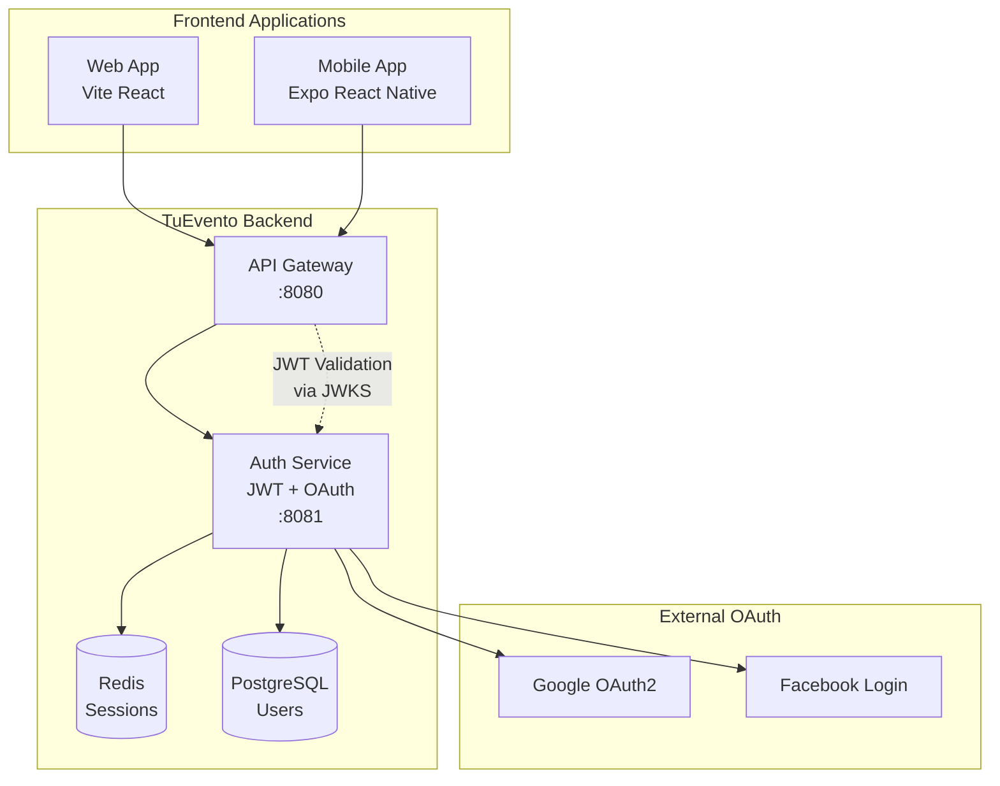
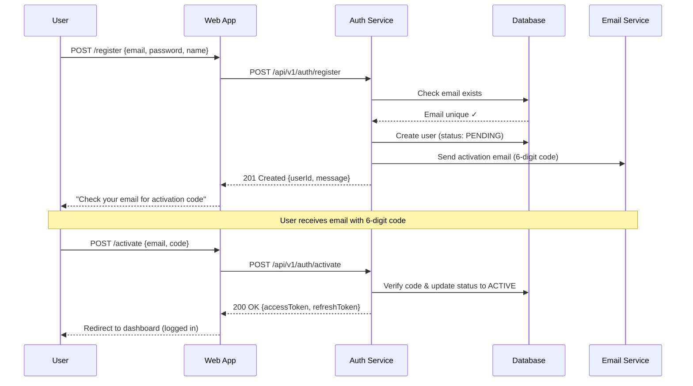
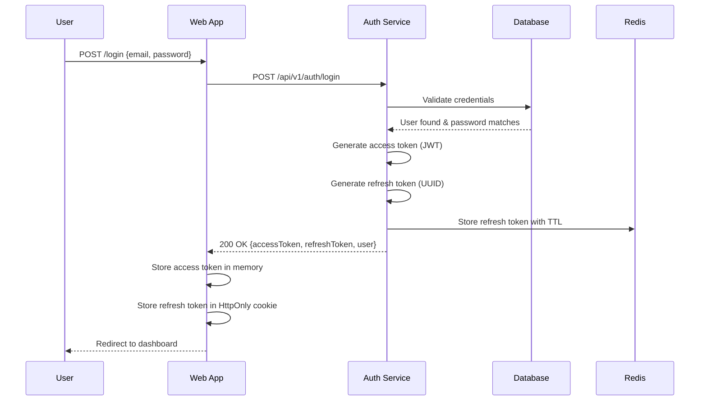
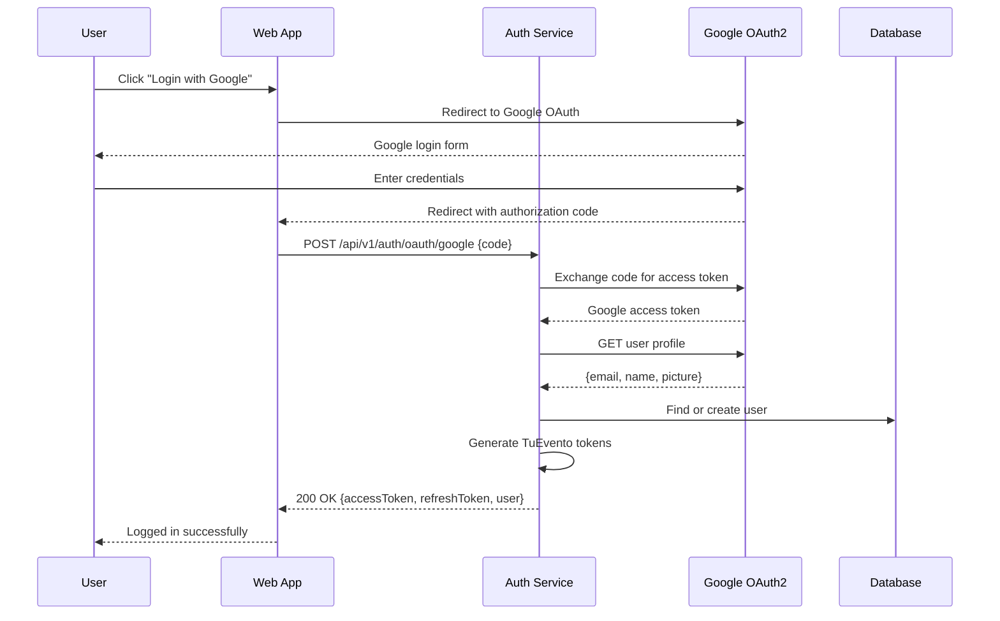
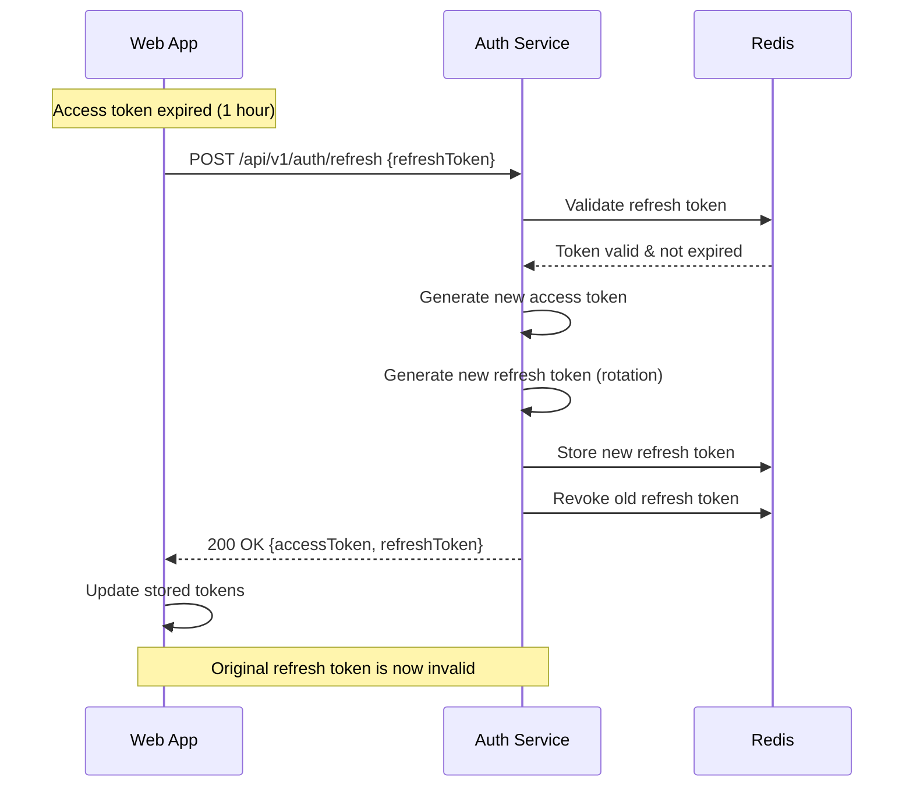
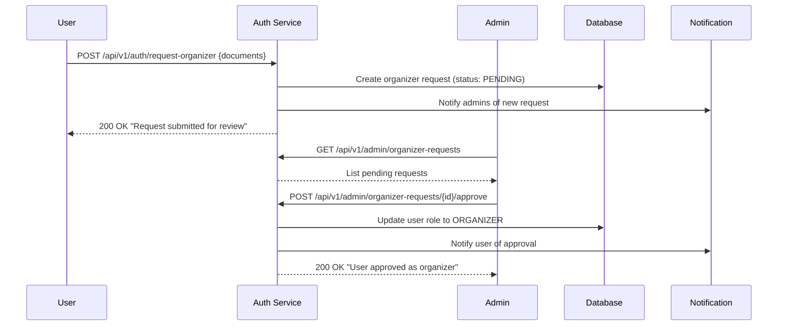

# TuEvento Authentication & Authorization

> **JWT-based security architecture for TuEvento** — Comprehensive authentication flow with refresh token rotation,
> role-based access control (RBAC), and OAuth2 social login integration.

---

## 1. Authentication Architecture

### Security Components



### Token Types & Lifecycle

| Token Type | Algorithm | Expiration | Storage | Purpose |
|------------|-----------|------------|---------|---------|
| **Access Token** | RS256 JWT | 1 hour | Memory/LocalStorage | API authentication |
| **Refresh Token** | Opaque (UUID) | 7 days | HttpOnly Cookie | Token renewal |
| **Activation Code** | 6-digit numeric | 15 minutes | Database | Email verification |
| **Reset Token** | UUID + timestamp | 1 hour | Database | Password reset |

---

## 2. JWT Access Token Structure

### Token Claims (Payload)
```json
{
  "sub": "550e8400-e29b-41d4-a716-446655440000",
  "email": "usuario@tuevento.com",
  "name": "María García",
  "roles": ["USER", "ORGANIZER"],
  "permissions": [
    "profile:read", "profile:write",
    "event:read", "event:write", 
    "seat:reserve", "ticket:purchase"
  ],
  "iat": 1642680000,
  "exp": 1642683600,
  "iss": "tuevento-auth-service",
  "aud": "tuevento-api"
}
```

### Header Structure
```json
{
  "alg": "RS256",
  "typ": "JWT",
  "kid": "auth-key-2024-01"
}
```

### Permission Format
**Pattern:** `{resource}:{action}`

**Examples:**
- `profile:read` → Can view own profile
- `profile:write` → Can edit own profile  
- `event:write` → Can create/edit events (organizers)
- `user:admin` → Full user management (admins)
- `seat:reserve` → Can reserve seats
- `payment:process` → Can process payments

---

## 3. Authentication Flow

### 3.1 User Registration



### 3.2 User Login (Email/Password)



### 3.3 OAuth2 Social Login



### 3.4 Token Refresh



---

## 4. Role-Based Access Control (RBAC)

### 4.1 Role Hierarchy

```
ADMIN (System Administrator)
  ├── Full system access
  ├── User management
  ├── Organizer approval
  └── System configuration
  
ORGANIZER (Event Organizer)  
  ├── Create/manage events
  ├── Design venue layouts
  ├── View sales reports
  └── Manage event settings
  
USER (Regular Attendee)
  ├── Browse events
  ├── Purchase tickets
  ├── Manage profile
  └── View purchase history
  
VIEWER (Read-only)
  ├── Browse public events
  └── View event details
  └── (Cannot purchase tickets)
```

### 4.2 Permission Matrix

| Resource | Action | USER | ORGANIZER | ADMIN |
|----------|--------|------|-----------|-------|
| **Profile** | Read own | ✅ | ✅ | ✅ |
| **Profile** | Write own | ✅ | ✅ | ✅ |
| **Profile** | Read others | ❌ | ❌ | ✅ |
| **Event** | Read public | ✅ | ✅ | ✅ |
| **Event** | Create | ❌ | ✅ | ✅ |
| **Event** | Edit own | ❌ | ✅ | ✅ |
| **Event** | Edit others | ❌ | ❌ | ✅ |
| **Event** | Delete | ❌ | Own only | ✅ |
| **Seat** | Reserve | ✅ | ✅ | ✅ |
| **Seat** | View all statuses | ❌ | Own events | ✅ |
| **Ticket** | Purchase | ✅ | ✅ | ✅ |
| **Ticket** | Refund | Own only | Own events | ✅ |
| **Payment** | Process | ✅ | ✅ | ✅ |
| **Payment** | View others | ❌ | Own events | ✅ |
| **User** | List all | ❌ | ❌ | ✅ |
| **User** | Promote role | ❌ | ❌ | ✅ |

### 4.3 Organizer Approval Process



---

## 5. Authorization Implementation

### 5.1 Middleware Chain

```java
@RestController
@RequestMapping("/api/v1/events")
@PreAuthorize("hasRole('ORGANIZER')")  // Class-level: Organizers only
public class EventController {
    
    @GetMapping
    @PreAuthorize("permitAll()")  // Override: Public endpoint
    public ResponseEntity<List<Event>> listEvents() { ... }
    
    @PostMapping  
    @PreAuthorize("hasPermission('event', 'create')")
    public ResponseEntity<Event> createEvent(@RequestBody CreateEventRequest request) { ... }
    
    @PatchMapping("/{id}")
    @PreAuthorize("hasPermission(#id, 'Event', 'write')")  // Owner or Admin only
    public ResponseEntity<Event> updateEvent(@PathVariable String id, ...) { ... }
}
```

### 5.2 Custom Permission Evaluator

```java
@Component
public class TuEventoPermissionEvaluator implements PermissionEvaluator {
    
    @Override
    public boolean hasPermission(Authentication auth, Object targetId, String targetType, Object permission) {
        String userId = auth.getName();
        
        // Check if user owns the resource
        if ("Event".equals(targetType) && "write".equals(permission)) {
            Event event = eventRepository.findById(targetId);
            return event.getCreatedBy().equals(userId) || hasRole(auth, "ADMIN");
        }
        
        // Check granular permissions
        return hasPermission(auth, targetType.toLowerCase() + ":" + permission);
    }
    
    private boolean hasPermission(Authentication auth, String permission) {
        return auth.getAuthorities().stream()
            .anyMatch(authority -> authority.getAuthority().equals(permission));
    }
}
```

---

## 6. Security Best Practices

### 6.1 Token Security

**Access Token Protection:**
- Store in memory/session storage (never localStorage for sensitive data)
- Include in `Authorization: Bearer {token}` header
- Automatic refresh before expiration
- Clear on logout/tab close

**Refresh Token Protection:**  
- Store in HttpOnly, Secure, SameSite=Strict cookie
- Single-use tokens (rotation on each refresh)
- Revoke on logout/password change
- Bind to user agent/IP for additional security

### 6.2 Attack Prevention

**Brute Force Protection:**
```json
{
  "maxAttempts": 5,
  "lockoutDuration": "15 minutes",
  "trackingBy": ["email", "ip"],
  "progressiveDelay": true
}
```

**Session Management:**
- Track concurrent sessions per user
- Allow session termination from profile
- Auto-logout on password change
- Device identification for security alerts

### 6.3 Audit Logging

**Authentication Events:**
```json
{
  "event": "USER_LOGIN_SUCCESS",
  "userId": "uuid",
  "email": "user@email.com",
  "ipAddress": "192.168.1.1",  
  "userAgent": "Mozilla/5.0...",
  "method": "PASSWORD",
  "timestamp": "2024-01-15T10:30:00Z"
}
```

**Authorization Events:**
```json
{
  "event": "PERMISSION_DENIED",
  "userId": "uuid",
  "resource": "Event",
  "resourceId": "event-uuid",
  "action": "DELETE",
  "requiredPermission": "event:admin",
  "userPermissions": ["event:read", "event:write"],
  "timestamp": "2024-01-15T10:30:00Z"
}
```

---

## 7. Error Responses

### Authentication Errors

**Invalid credentials (401):**
```json
{
  "error": "INVALID_CREDENTIALS",
  "message": "Email o contraseña incorrectos",
  "traceId": "req-uuid"
}
```

**Account locked (423):**
```json
{
  "error": "ACCOUNT_LOCKED",  
  "message": "Cuenta bloqueada por múltiples intentos fallidos",
  "unlockAt": "2024-01-15T10:45:00Z",
  "traceId": "req-uuid"
}
```

**Token expired (401):**
```json
{
  "error": "TOKEN_EXPIRED",
  "message": "El token de acceso ha expirado",
  "expiredAt": "2024-01-15T10:30:00Z",
  "traceId": "req-uuid"
}
```

### Authorization Errors

**Insufficient permissions (403):**
```json
{
  "error": "INSUFFICIENT_PERMISSIONS",
  "message": "No tienes permisos para realizar esta acción",
  "requiredPermission": "event:write",
  "userRole": "USER",
  "traceId": "req-uuid"
}
```

**Resource ownership (403):**
```json
{
  "error": "RESOURCE_ACCESS_DENIED",
  "message": "Solo puedes editar tus propios eventos",
  "resourceId": "event-uuid",
  "traceId": "req-uuid"
}
```

---

## 8. JWKS Public Keys

### Key Distribution Endpoint

**Endpoint:** `GET /api/v1/auth/jwks`
```json
{
  "keys": [
    {
      "kty": "RSA",
      "kid": "auth-key-2024-01",
      "use": "sig",
      "alg": "RS256",
      "n": "base64-encoded-modulus",
      "e": "AQAB"
    }
  ]
}
```

### Key Rotation Strategy
- **Active keys:** 2 keys (current + previous) for zero-downtime rotation
- **Rotation frequency:** Every 90 days
- **Grace period:** 24 hours overlap for token validation
- **Emergency rotation:** Immediate rotation if key compromise suspected

---

## 9. Integration Examples

### 9.1 Frontend Authentication (React)

```typescript
// Auth context/hook
export const useAuth = () => {
  const [accessToken, setAccessToken] = useState<string | null>(null);
  const [user, setUser] = useState<User | null>(null);
  
  const login = async (email: string, password: string) => {
    const response = await fetch('/api/v1/auth/login', {
      method: 'POST',
      headers: { 'Content-Type': 'application/json' },
      body: JSON.stringify({ email, password }),
      credentials: 'include' // Include refresh token cookie
    });
    
    if (response.ok) {
      const { accessToken, user } = await response.json();
      setAccessToken(accessToken);
      setUser(user);
      
      // Set up automatic token refresh
      scheduleTokenRefresh(accessToken);
    }
  };
  
  const refreshToken = async () => {
    const response = await fetch('/api/v1/auth/refresh', {
      method: 'POST',
      credentials: 'include'
    });
    
    if (response.ok) {
      const { accessToken } = await response.json();
      setAccessToken(accessToken);
      scheduleTokenRefresh(accessToken);
    } else {
      // Refresh failed, redirect to login
      logout();
    }
  };
};

// API request interceptor
axios.interceptors.request.use((config) => {
  const token = getAccessToken();
  if (token) {
    config.headers.Authorization = `Bearer ${token}`;
  }
  return config;
});

// Response interceptor for token refresh
axios.interceptors.response.use(
  (response) => response,
  async (error) => {
    if (error.response?.status === 401) {
      try {
        await refreshToken();
        // Retry original request
        return axios(error.config);
      } catch {
        // Refresh failed, logout user
        logout();
      }
    }
    return Promise.reject(error);
  }
);
```

### 9.2 Backend Authorization (Spring Security)

```java
@Configuration
@EnableWebSecurity
@EnableGlobalMethodSecurity(prePostEnabled = true)
public class SecurityConfig {
    
    @Bean
    public SecurityFilterChain filterChain(HttpSecurity http) throws Exception {
        return http
            .authorizeHttpRequests(auth -> auth
                .requestMatchers("/api/v1/auth/**").permitAll()
                .requestMatchers("/api/v1/health").permitAll()
                .requestMatchers(HttpMethod.GET, "/api/v1/events").permitAll()
                .requestMatchers("/api/v1/admin/**").hasRole("ADMIN")
                .anyRequest().authenticated()
            )
            .oauth2ResourceServer(oauth2 -> oauth2
                .jwt(jwt -> jwt
                    .jwkSetUri("http://auth-service:8081/api/v1/auth/jwks")
                    .jwtAuthenticationConverter(jwtAuthenticationConverter())
                )
            )
            .sessionManagement(session -> session
                .sessionCreationPolicy(SessionCreationPolicy.STATELESS)
            )
            .csrf(csrf -> csrf.disable())
            .build();
    }
    
    @Bean
    public JwtAuthenticationConverter jwtAuthenticationConverter() {
        JwtAuthenticationConverter converter = new JwtAuthenticationConverter();
        converter.setJwtGrantedAuthoritiesConverter(jwt -> {
            // Extract roles and permissions from JWT claims
            List<String> roles = jwt.getClaimAsStringList("roles");
            List<String> permissions = jwt.getClaimAsStringList("permissions");
            
            List<GrantedAuthority> authorities = new ArrayList<>();
            
            // Add roles with ROLE_ prefix
            roles.forEach(role -> authorities.add(new SimpleGrantedAuthority("ROLE_" + role)));
            
            // Add permissions as-is
            permissions.forEach(permission -> authorities.add(new SimpleGrantedAuthority(permission)));
            
            return authorities;
        });
        return converter;
    }
}
```

---

## 10. Testing Strategy

### 10.1 Unit Tests

```java
@SpringBootTest
class AuthenticationServiceTest {
    
    @Test
    void shouldGenerateValidJwtToken() {
        User user = createTestUser();
        String token = authService.generateAccessToken(user);
        
        // Verify token structure and claims
        assertThat(jwtDecoder.decode(token))
            .extracting("sub", "email", "roles")
            .containsExactly(user.getId(), user.getEmail(), user.getRoles());
    }
    
    @Test
    void shouldRefreshTokenSuccessfully() {
        String refreshToken = "valid-refresh-token";
        when(redisTemplate.hasKey(refreshToken)).thenReturn(true);
        
        AuthResponse response = authService.refreshToken(refreshToken);
        
        assertThat(response.getAccessToken()).isNotNull();
        assertThat(response.getRefreshToken()).isNotEqualTo(refreshToken); // Token rotation
    }
    
    @Test
    void shouldLockAccountAfterMaxFailedAttempts() {
        String email = "test@example.com";
        
        // Simulate 5 failed login attempts
        IntStream.range(0, 5).forEach(i -> authService.login(email, "wrong-password"));
        
        // 6th attempt should result in account lock
        assertThatThrownBy(() -> authService.login(email, "wrong-password"))
            .isInstanceOf(AccountLockedException.class);
    }
}
```

### 10.2 Integration Tests

```java
@SpringBootTest(webEnvironment = SpringBootTest.WebEnvironment.RANDOM_PORT)
class AuthenticationIntegrationTest {
    
    @Test
    void shouldCompleteFullAuthenticationFlow() {
        // Register user
        RegisterRequest registerRequest = new RegisterRequest("test@example.com", "password123", "Test User");
        ResponseEntity<AuthResponse> registerResponse = restTemplate.postForEntity("/api/v1/auth/register", registerRequest, AuthResponse.class);
        assertThat(registerResponse.getStatusCode()).isEqualTo(HttpStatus.CREATED);
        
        // Login user
        LoginRequest loginRequest = new LoginRequest("test@example.com", "password123");
        ResponseEntity<AuthResponse> loginResponse = restTemplate.postForEntity("/api/v1/auth/login", loginRequest, AuthResponse.class);
        assertThat(loginResponse.getStatusCode()).isEqualTo(HttpStatus.OK);
        
        String accessToken = loginResponse.getBody().getAccessToken();
        
        // Access protected resource
        HttpHeaders headers = new HttpHeaders();
        headers.setBearerAuth(accessToken);
        HttpEntity<String> entity = new HttpEntity<>(headers);
        
        ResponseEntity<UserProfile> profileResponse = restTemplate.exchange("/api/v1/profile", HttpMethod.GET, entity, UserProfile.class);
        assertThat(profileResponse.getStatusCode()).isEqualTo(HttpStatus.OK);
    }
}
```

---

## Correlations

- **Security Requirements** → `04-requirements/evidence/functional.md` (FR-001 to FR-010)
- **Security Architecture** → `05-architecture/evidence/ADR-005-jwt-refresh-token-auth.md`
- **API Guidelines** → `07-api/evidence/guidelines.md` (Section 5: Authentication)
- **OpenAPI Contract** → `07-api/contracts/openapi/auth-service.yaml`
- **Security Policy** → `00-governance/evidence/security-rules.md`